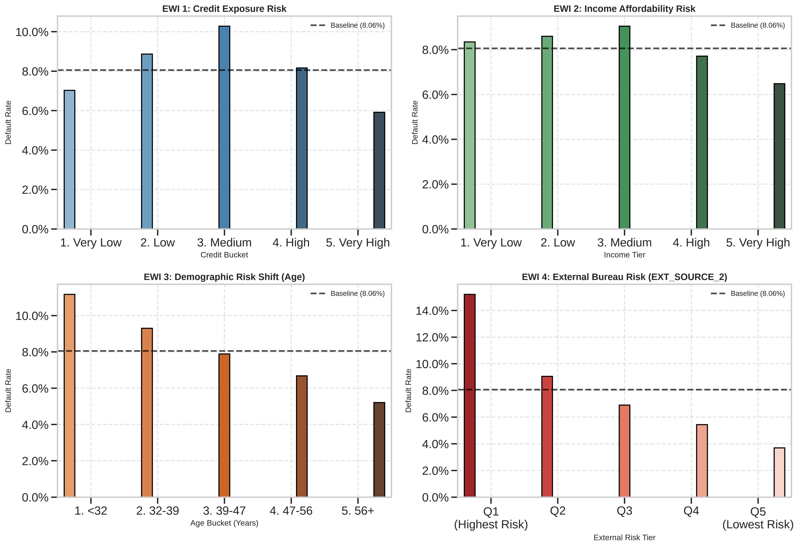
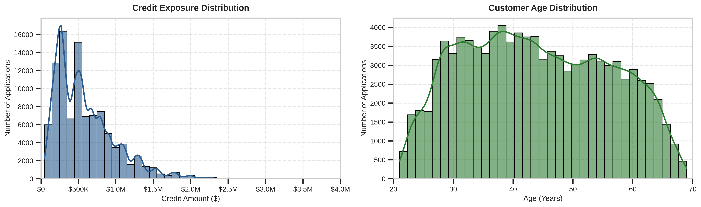
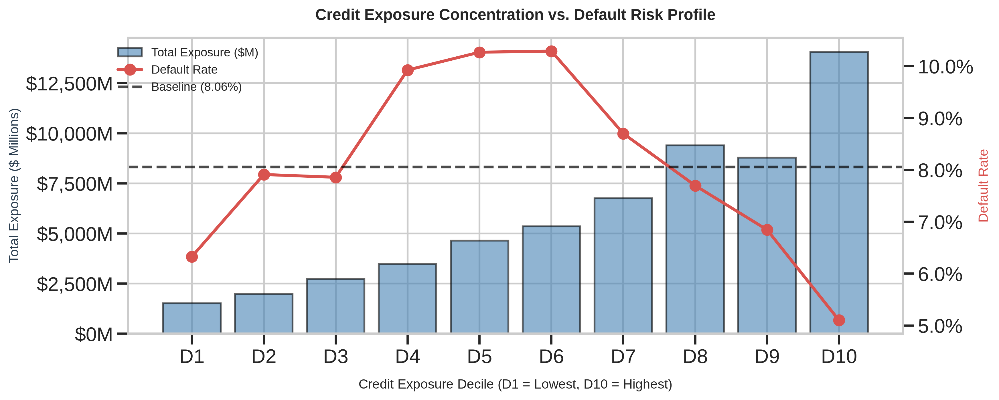

# 📊 Credit Risk Portfolio Analytics & Management Framework

[](https://www.python.org/)
[](https://pandas.pydata.org/)
[](https://seaborn.pydata.org/)
[](https://jupyter.org/)
[](LICENSE)

> A management-oriented credit analytics and early warning monitoring framework for consumer lending portfolios, translating granular loan application data into executive policy decisions and risk steering strategies.

---

## 🎯 Executive Overview

This repository demonstrates how a **Business Analytics & Credit Risk** function drives portfolio steering, risk monitoring, and governance in a non-banking financial institution (NBFI). 

Rather than focusing on black-box predictive modeling, the analysis emphasizes:
- **Baseline Portfolio Health:** Establishing reference risk rates and affordability benchmarks.
- **Risk Concentration & Exposure:** Identifying where aggregate loan losses cluster across ticket sizes.
- **Early Warning Indicators (EWIs):** Proactively detecting risk drift before delinquency materializes.
- **Actionable Governance:** Translating analytical findings into credit limit caps, pricing tiers, and underwriting cut-offs.

---

## 🗂️ Analytical Workflow & Notebook Structure

The project follows an end-to-end management reporting lifecycle structured across 4 sequential notebooks:

```text
credit-risk-portfolio-analytics/
├── archive/
│   └── feature_matrix.csv                       # Consolidated feature matrix (gitignored)
├── notebooks/
│   ├── 01_business_context_data_overview.ipynb  # Portfolio baseline KPIs & exposure distributions
│   ├── 02_portfolio_kpis_and_segmentation.ipynb # Multi-dimensional risk segmentation (Credit, Income, Bureau)
│   ├── 03_credit_risk_early_warning_indicators.ipynb # 4-Pillar Early Warning Indicator (EWI) dashboard
│   └── 04_management_insights_and_decision_support.ipynb # Executive decision matrices & policy recommendations
├── src/                                         # Utility scripts and plotting helpers
├── requirements.txt                             # Python dependencies
└── README.md
```

### Module Breakdown

1. **`01_business_context_data_overview.ipynb`**
   - Business positioning and exploration of consolidated consumer credit records.
   - Target hygiene (handling sentinel missing value codes like `-999`).
   - Baseline KPI definitions (analyzed volume, mean credit ticket, observed default baseline).

2. **`02_portfolio_kpis_and_segmentation.ipynb`**
   - Quantile segmentation across exposure (`AMT_CREDIT`), income tiers (`AMT_INCOME_TOTAL`), and demographics (`AGE_YEARS`).
   - Bureau score calibration using `EXT_SOURCE_2`.
   - Multi-dimensional portfolio concentration analysis (Volume % vs. Exposure % vs. Default %).

3. **`03_credit_risk_early_warning_indicators.ipynb`**
   - Construction of a 4-pillar Early Warning Indicator (EWI) framework.
   - Calculation of risk spread metrics relative to portfolio baseline (8.06%).
   - Identification of adverse selection in lower income tiers and younger borrower cohorts.

4. **`04_management_insights_and_decision_support.ipynb`**
   - Executive dashboard synthesis and risk-vs-exposure decile modeling.
   - Operational policy matrix assigning risk thresholds to specific business owners.
   - Portfolio steering framework balancing **Growth vs. Risk vs. Profitability**.

---
## 🖼️ Portfolio Visual Insights

<p align="center">
  
  <br>
  <em>Figure 1: 4-Pillar Early Warning Indicator (EWI) Risk Dashboard vs. Portfolio Baseline (8.06%)</em>
</p>

<table width="100%">
  <tr>
    <td width="50%" align="center">
      
      <br><strong>Figure 2:</strong> Credit Exposure & Demographics
    </td>
    <td width="50%" align="center">
      
      <br><strong>Figure 3:</strong> Exposure Concentration vs. Default Rate
    </td>
  </tr>
</table>

## 📈 Baseline Portfolio Snapshot

| Metric | Sample Portfolio Value | Management Description |
| :--- | :--- | :--- |
| **Analyzed Applications** | `100,000` | Full analyzed sample size |
| **Observed (Labeled) Loans** | `86,173` | Training cohort with known repayment outcome |
| **Portfolio Default Rate** | `8.06%` | Baseline portfolio risk benchmark |
| **Average Credit Exposure** | `$586,964.74` | Mean requested loan amount |
| **Average Annual Income** | `$170,680.03` | Borrower baseline affordability index |

---

## 🚦 Early Warning Indicator (EWI) Governance Matrix

| EWI Pillar | High-Risk Cohort | Observed Risk Rate | Spread vs. Baseline | Recommended Management Action |
| :--- | :--- | :--- | :--- | :--- |
| **EWI 1: Credit Size** | Deciles 1–2 (Micro-loans) | ~10.5% | `+2.44%` | Review adverse selection in fast-approval channels |
| **EWI 2: Affordability** | Tier 1 (Lowest Income) | ~9.8% | `+1.74%` | Cap maximum Debt-Burden Ratio (DBR) at 40% |
| **EWI 3: Demographics** | Young Applicants (<32 yrs) | ~11.2% | `+3.14%` | Require employment proof / co-signers |
| **EWI 4: Bureau Score** | Score Quintile 1 (Lowest) | >15.0% | `+7.00%+` | Implement hard automated underwriting cut-offs |

---

## 🚀 Quickstart & Reproduction

### 1. Clone Repository & Setup Virtual Environment
```bash
git clone https://github.com/your-username/credit-risk-portfolio-analytics.git
# Create and activate virtual environment
python -m venv venv
source venv/bin/activate  # On Windows: venv\Scripts\activate

# Install dependencies
pip install -r requirements.txt
```

### 2. Dataset Setup
Download the Home Credit Feature Matrix and place it in the `archive/` folder:
```text
archive/feature_matrix.csv
```

### 3. Launch Notebooks
```bash
jupyter lab
```

---

## 🛠️ Tech Stack & Dependencies

- **Python 3.10+**
- **Data Wrangling:** `pandas >= 2.0.0`, `numpy >= 1.24.0`
- **Visualization:** `matplotlib >= 3.7.0`, `seaborn >= 0.13.0`
- **Interactive Environment:** `jupyterlab >= 4.0.0`

---

## ⚖️ Analytical Disclaimer

This project is built for business analytics demonstration and management decision simulation. Target variables and derived scores reflect feature-engineered proxies rather than live production default classifications. All cutoff recommendations and thresholds should undergo vintage and loss forecasting validation prior to production deployment.

---

## 📄 License
Distributed under the MIT License. See `LICENSE` for details.
